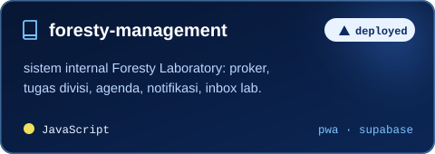
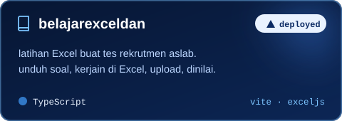
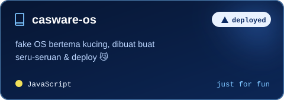
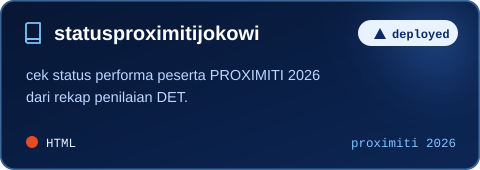
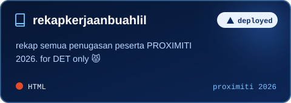
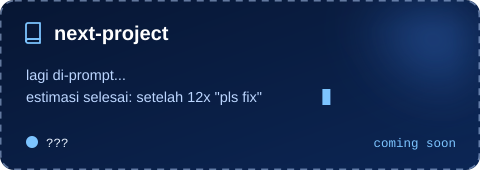

<div align="center">



<a href="https://github.com/imight-dead">
  
</a>

<br/>


<br/><br/>



</div>

## `> ls ~/projects`

<p align="center">
  <a href="https://github.com/imight-dead/foresty-management"></a>
  <a href="https://github.com/imight-dead/belajarexceldan"></a>
  <a href="https://github.com/imight-dead/casware-os"></a>
  <a href="https://github.com/imight-dead/statusproximitijokowi"></a>
  <a href="https://github.com/imight-dead/rekapkerjaanbuahlil"></a>
  
</p>

<p align="center">
  <sub>+ <b>100++++ private repo</b> yang mandek di tengah jalan. rip 🪦</sub>
  <br/>
  <sub><b>▲ live:</b>
  <a href="https://foresty-management.vercel.app">foresty</a> ·
  <a href="https://belajarexceldan.vercel.app">belajarexceldan</a> ·
  <a href="https://casware-os-steel.vercel.app">casware-os</a> ·
  <a href="https://proximiticheck2026.vercel.app">proximiti check</a> ·
  <a href="https://rekappenugasan26.vercel.app">rekap penugasan</a></sub>
</p>

## `> which --all tools`

<p align="center">
  
  <br/>
  <sub><i>+ AI (rekan kerja paling sabar, walau kadang ngeyel)</i></sub>
</p>

## `> htop`

<p align="center">
  
</p>

## `> top -u radhi`

<p align="center">
  
  
  <br/>
  
  <br/>
  
</p>

## `> cat cat_facts.json`

```json
{
  "user": "radhispace",
  "os": "casware-os v9.lives",
  "uptime": "kurang tidur sejak 2019",
  "current_mission": "deploy dulu, mikir belakangan",
  "security": {
    "firewall": "kucing",
    "antivirus": "kucing juga",
    "2FA": "kucing duduk di atas laptop"
  },
  "favorite_command": "git commit -m 'fix' && pray",
  "lives_remaining": 7,
  "stackoverflow_visits": "turun 97% sejak kenal AI"
}
```

<br/>

<p align="center">
  
</p>
